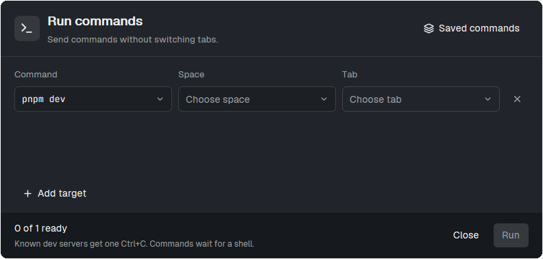
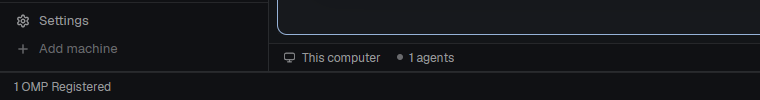

# herdr-mods

Two mods for the [Herdr desktop app](https://herdr.dev/). Install either one independently; neither requires the other or a custom layout.

## [Command Runner](command-runner/)

[](command-runner/)

Send saved commands to shells or running agents across spaces without switching tabs. Add one row per destination, then run the batch. [Install and use Command Runner](command-runner/README.md) · [Rebuild recipe](command-runner/RECIPE.md)

```text
Read the installed Herdr guide at ~/.config/herdr-app/AGENTS.md, then add this mod: https://github.com/Morfusee/herdr-mods/tree/main/command-runner
```

## [OMP Resume](omp-resume/)

[](omp-resume/)

Resume registered OMP sessions after a Herdr restart on Windows. The PowerShell installer sets up both the Herdr mod and the OMP hook. [Install and use OMP Resume](omp-resume/README.md) · [Rebuild recipe](omp-resume/RECIPE.md)

```text
Read the installed Herdr guide at ~/.config/herdr-app/AGENTS.md, then add this mod: https://github.com/Morfusee/herdr-mods/tree/main/omp-resume
```

Updating an existing clone of `herdr-omp-resume`? Pull the latest `main`, then run `pwsh -NoProfile -File ./omp-resume/install.ps1` from the checkout root. The installed mod and hook names have not changed.

## Development

From the repo root, run `pnpm install --frozen-lockfile`, then `pnpm format` to format JavaScript, TypeScript, and JSON in both mods. Use `pnpm format:check` to check without writing. Neither mod needs pnpm or oxfmt at runtime.

[MIT license](LICENSE). OMP Resume also includes its [upstream MIT notice](omp-resume/mods/omp-resume/LICENSE).
