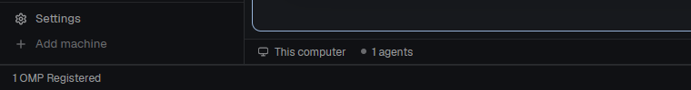

# OMP Resume

Resume OMP agents in Herdr on Windows.

## What you see

Below the existing Herdr layout, dock one full-width, 28 px bottom strip. Use the theme's `chrome` background and a 1 px top rule in `border`. The single line `x OMP Registered` starts 14 px from the left and is vertically centered. It uses the app's UI font at 11.8 px in `muted`. Use `blocked` for the text if registry work fails. There are no icons or other art. The preview is cropped from a Herdr window with one test session. The rest of the window is not part of the mod.

## How it behaves

- Working, blocked, done, and idle OMP agents all count the same. The strip shows registration, not agent status. It does not change their appearance in the sidebar.
- The count starts at zero in a clean app home. A new session registers when OMP publishes its identity. A session switch replaces the record for that pane. An idle restart keeps it. An exit, pane close, or space close removes it.
- Hover changes the pointer to a hand. Clicking requests another registry check. It does not open a picker or repeat a reserved resume attempt. Errors show a Herdr toast; a missing saved conversation shows a warning.
- The strip does not animate, move panes, or take keyboard focus. There are no key bindings and no `keys.json` snippet.
- An optional service-only copy draws nothing. A custom status bar can display the same count instead. Mount one copy, not a footer and a service at the same time.

## Built from

1. **Mount.** Put `main.js`, `registry.js`, and `mod.json` in `mods/omp-resume/`. Set `mod.json` to `{ "place": "bottom", "size": 28 }`. Default-export a `View` from `gpui-kit` and render the strip with `h_flex` from `gpui-base`. Use `theme()` colors. When `init(props)` receives `service: true`, render an empty full-size element. For inline use, move the same block into the user's status row at 1 px with this prop. No shipped mod, art, or layout file is needed.
2. **Refresh.** Use `agents()`, `panes()`, `spaces()`, and `terminals()` as the live model. Start work only if `checking()` is false and the local `machines()` entry's layout is `ready`. Compare a signature of pane membership, space/tab metadata, agent app, terminal state, PID, creation time, report flag, foreground, and the two labels below. Include `shared("omp-resume.refresh")` in the signature. Run one job at a time with `cx.spawn`; notify on completion. Do not poll. Expose the number as `omp-resume.registered` and error text or null as `omp-resume.error` via `setShared()`. Clicking the text sets `omp-resume.refresh` to `Date.now()`.
3. **Identify.** Bundle an OMP TypeScript hook at `omp/revive.ts` inside the mod. OMP loads a copy at `$HOME/.omp/agent/extensions/herdr-omp-resume.ts`. Subscribe to `session_start`, `session_switch`, `session_branch`, `session_tree`, `agent_end`, and `turn_end`. Get the UUID and session file from `ctx.sessionManager` and the folder from `ctx.cwd`. Read the optional profile from `--profile` or `OMP_PROFILE`, in that order. Require absolute paths without control characters and a valid profile name or null. Restrict the hook to a top-level interactive main agent with `HC_TERMINAL_ID`. Ignore nested `OMPCODE=1` runs, subagents, print, non-text modes and `--no-session`. Send `hc label <terminal> omp.resume=<JSON>` with `{sessionId, sessionFile, cwd, profile}` using `execFile`, not a shell. Serialize label writes and skip unchanged payloads. Never clear the label on shutdown.
4. **Save.** Read `appHome()/omp-sessions.json` with `readTextFile()`. Use `{version: 2, sessions: [...]}`; a missing file is empty. Keep one local record per live pane with a reported or foreground OMP process and a valid identity. Match prior records by terminal address and creation time. Retain that identity while an OMP restart leaves no new label, or while a kept pane waits for its replacement shell. Replace the record on session switch. Drop ordinary shell returns, non-OMP agents, and closed panes. Each record stores `terminal`, `pane`, `space`, `tab`, `spaceName`, `tabName`, `cwd`, `sessionId`, `sessionFile`, `profile`, `command`, `rootPid`, and `createdMs`. Derive the command array from the identity: `omp [--profile <profile>] --session-dir <parent of session file> --resume <UUID>`. Migrate version 1 records with saved IDs, excluding closed, ended, and switched records. Reject invalid metadata, duplicate terminal entries, and version 2 commands that differ from the derived array. Write only changed JSON with `writeTextFile(path, next, previous)`, then publish the count. On failure, leave invalid input untouched and use `notify()` and the shared error key.
5. **Resume.** On the first refresh, queue only records already on disk. Give pending terminal metadata up to 30 seconds to arrive via model changes. Require the same live kept terminal, creation time, pane, tab, and space labels, but a different root PID. Require that `pwsh.exe` or `powershell.exe` is the foreground process at that PID and that the terminal has not reported a program. Skip sessions already open in a different live OMP agent. Run `exec("node", ...)` only to check that the saved session file exists. Recheck with `hc(["get", terminal, "--json"])` and current pane data. Reserve `omp.resume.attempt=<rootPid>:<sessionId>` via `hc label` before using `hc send` to send the command. Put `Set-Location -LiteralPath` with `-ErrorAction Stop` before the `&` invocation. Single-quote each path and argument; double ASCII and curly single quotes within them. Never send a prompt.

## Watch out

- Windows, Herdr with the `hc` CLI, Node.js, and OMP with the interactive session APIs are required. PowerShell 7 runs the optional installer. Only local PowerShell replacement shells are recovery targets. A normal app reopen does nothing to agents still running.
- Copying `mods/omp-resume/` installs only the Herdr half. Use the [installer](README.md#install) to copy the hook too. An already-open OMP needs one manual `/restart` to load it. Do not add another extension, modify the PowerShell profile, or ship a `layouts/` folder.
- If the selected layout has no footer, clone the layout and add one 28 px bottom block with `content: { mod: "omp-resume" }`. The clean preview window needed this step. Do not modify a shipped layout.
- The mod reads and writes the registry outside its own folder and checks for the saved session file. It runs local `node` and `hc` commands. The hook runs `hc label`. Neither component makes network requests. The registry holds private paths and IDs; never distribute it.
- Do not infer an ID from a session file lock, a process handle, or recent files. An idle restart may have no writer lock. A conversation that OMP has not yet saved cannot be recovered. Use `--resume`, not `--restore`, and do not treat `/exit` as a lost process.
- Keep the upstream MIT notice for the lifecycle approach and PowerShell quoting adapted from [Revive for Windows](https://github.com/RAF1337/herdr-revive-win).

## Done when

- `herdr-app check mods/omp-resume` passes without file writes or process launches. In a real Herdr window, the footer fits in one row and shows the active registry count. Service mode draws no second counter.
- A main interactive OMP registers once. Two idle restarts keep the same ID and command. Switching conversation replaces its entry. Exiting or closing the pane removes it. A nested or headless session cannot register over it.
- On startup a saved conversation resumes once in its retained replacement PowerShell pane. An open agent, busy shell, ordinary shell return, closed pane, or missing file receives no command.
- An invalid registry or altered command causes an error without overriding the file. Clicking the count after correcting the file refreshes the count. A clean install and an unchanged reinstall preserve unrelated config and runtime data.
