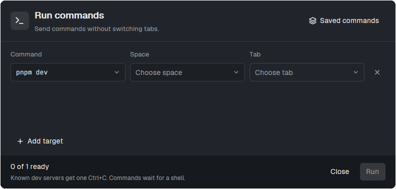

# Command Runner

Open a compact Run commands overlay over your Herdr workspace. Choose a saved command and where to send it, add more targets if needed, and see the submission result on each row without switching tabs. A separate Saved commands view edits the list used by all targets.

## What you see

- A 720 × 344 px overlay with a theme `surface` body and 13 px foreground text. The header has 18 px side padding, a 34 px raised icon tile with an 18 px terminal glyph, the 17 px semibold title **Run commands**, and the 12 px muted subtitle **Send commands without switching tabs.** **Saved commands** sits at the right.
- Under the header, three equal columns are labeled **Command**, **Space**, and **Tab** in 12 px muted text. Each target row has 32 px tall pickers and a trailing X button. Keep the X visible, muted and disabled when only one row remains. A separate **Terminal** picker appears below the row if there are multiple terminal panes or a sole terminal still needs selection. Status text sits below the pickers. The target list scrolls above a quiet **Add target** button.
- The bottom `chrome` strip has a top border, the ready count or **Batch submitted**, and a muted note explaining that agents receive text and only recognized dev servers get Ctrl+C. **Close** and the accent-filled **Run** button sit at the right. The latter reads **Run n targets** for more than one pending row, and **Running…** during submission. A disabled primary button uses `raised` and `muted`.
- Pickers have a one-pixel `input` border that changes to `accent` on focus or open. Saved command labels use 12 px monospace, the configured font family or JetBrains Mono. A top-left anchored `popover` uses a 7 px radius, large shadow and width of min(360 px, viewport width minus 16 px), down to 1 px. It begins with a 36 px **Type to filter…** input. The scrollable results are 30 px tall for commands, 42 px for other choices, capped at 218 px and constrained by the viewport. Use `selected` for the active match, `hover` for hover, and an accent check for the selected value. Show **No matches.** if empty.
- Space results show name and a muted 11 px machine and folder detail. A linked worktree indents 22 px, shows a 13 px branch icon and includes its parent name in the detail. A selected worktree reads **Parent › Worktree**. Tab details show the tab index. Terminal options show the program name (or **Terminal**), address, and folder.
- **Saved commands** reuses the header with a layers icon and **Back**. Save either shell commands or agent input, such as `/restart`. A 34 px monospace input and **Save command** button sit above a scrolling list. Each 40 px row has a muted terminal glyph, a truncated 12 px monospace command, and **Remove**. An empty list reads **Save your first command above.**

## How it behaves

- Open the overlay on demand, not as a dock. It starts with one row, the first saved command selected (initially `pnpm dev`), and no target. Focus the command picker if it has a value, otherwise the form. Click **Saved commands** to add or remove entries, and **Back** to return. Save trims the input; a blank, control-containing or duplicate entry cannot be saved. Enter in the input also saves. Removing a command clears it on matching targets.
- Click a picker or press Space on its focused trigger to open it. Type to filter labels and details without regard to case. Up/Down move the highlighted match without wrapping; Enter or a click selects it. Escape or an outside press dismisses the menu. Tab and Shift+Tab dismiss it and move to the next or previous control. Scroll the list without scrolling the overlay. Hover shows a tooltip with the relevant label or detail. There are no global key bindings.
- Choose the space, then the tab. Changing space clears the tab; changing tab selects its sole terminal or clears the terminal choice. A tab without terminals reports an error. Linked worktrees group beneath the first known main space on the same machine as Git results arrive. Keep unmatched spaces in place and keep names independent of their IDs. If the active match moves, scroll to keep it visible.
- **Add target** copies the previous row's command, but not its target. X removes a row except the last. Disable Run until every pending row is valid. Mark duplicate terminals and closed spaces, tabs, or terminals invalid. While busy, disable the pickers and form actions. Valid rows submit independently. Use `muted` for **Checking terminal…**, `done` for **Submitted**, and `blocked` for an error. Do not resubmit successful rows unless the user makes a selection on that row again. **Close** dismisses the overlay.
- Pin the receiving app when the terminal is selected. Show **Send to OMP** when OMP is running in the foreground, or **Run in shell** for a shell target. Require reselection if the program changes. Never send `/restart` to a shell. Turn status does not determine eligibility. **Sent to** acknowledges delivery to the named app, not completion of the command.

## Built from

1. **Mount.** Put `main.js`, `dispatch.js`, `space-options.js`, and `mod.json` in `mods/command-runner/`. Set `mod.json` to `{"place":"none","overlay":{"width":720,"height":344}}`. Open with `mod.open {name:"command-runner"}`. `init` uses the overlay prop to set focus; `closeOverlay(props().overlay)` closes it. Export a `View` using `div` and `svg` from `gpui-kit` and `Button`, `Input`, `InputState`, `Popup`, `ScrollHandle`, `Select`, `h_flex`, and `v_flex` from `gpui-base`. Use `theme()` and `settings()` rather than hard-coded theme colors. Use Herdr's shipped `mods/workspace-chrome/{terminal,layers,chevron-left,chevron-down,search,branch,check,x,plus}.svg`, tinted by text color. Do not bundle art or a layout. A personal tabs clone can add a Commands button after Changes with `run("mod.open", {name:"command-runner"})`.
2. **Form.** Read live `spaces()` and `panes()` for options and validate membership. Read and write only the saved strings with `shared()` and `setShared()` under `command-runner.commands`; target rows live in the view only. Mount searchable `Select` popups with a focus handle and `ScrollHandle`. Scope `cx.bind_keys()` to `CommandRunnerOptions`. After the popup mounts, focus the search input with `cx.timer.after(0, …)`.
3. **Group.** Use the first pane working directory per space, falling back to its configured folder. Cache one result per machine and directory for the overlay; query at initialization and when opening the Space picker. Use `cx.spawn` and `exec("git", ["rev-parse", "--path-format=absolute", "--absolute-git-dir", "--git-common-dir", "--is-inside-work-tree"], {cwd, on: machine})`. Key repository identity by machine and common Git directory. A different Git directory marks a linked worktree. Group only if both worktree and main are known; preserve root and child order. Skip queries during `checking()`.
4. **Dispatch.** On Run, skip `checking()` and use `cx.spawn` for pending rows. Use `spaces()`, `panes()`, `terminals()`, and `hc(["get", "--json", "--", terminal])` to recheck the selected pane, original launch and address. Preserve machine-qualified addresses and compare membership labels with on-machine IDs. For an agent target, verify the same reported app and foreground process, then submit its text once with `hc send`. Leave Herdr's draft and approval protections in place. Never fall back to keystrokes or shell input. For a shell target, reject agent metadata; read the visible screen and recheck foreground identity to establish a clean prompt. Interrupt only a recognized dev server, once. Recheck every 250 ms for up to five seconds before sending the shell command. Require integer `turn` acknowledgments. Never escalate or auto-retry.

## Watch out

- Treat live shell checks as conservative heuristics, not a sandbox. Accept interactive Bash, Dash, Fish, Ksh, Sh, Zsh, Cmd, and PowerShell launch shapes, including the core's PowerShell prompt shim. Reject commands with control characters or line breaks before sending. Preserve the saved command text as one argument. Do not confuse a root shell PID with a clean prompt; a builtin or draft can still own the screen.
- Restrict server recognition to `python[3[.x]] [-u] -m http.server`, `next dev`, and `node …/node_modules/next/dist/bin/next dev`. A generic package script or an unrelated replacement process is not safe to interrupt. A missing write acknowledgment may still mean input arrived; do not retry for the user.
- The code targets Herdr Desktop 0.1.16 and uses its shipped icon paths. Git is optional; unknown repositories stay ungrouped. Git queries can run remotely through Herdr. No direct network API, installer, bundled shell tools, or `keys.json` is needed. Saved commands persist in readable shared state; a command itself may do anything the shell can do.

## Done when

- The overlay opens on demand without changing the active tab. Its last remove button is always visible and disabled. Adding a row copies the command but not the target. Multiple terminals in a tab can be chosen explicitly.
- Each picker filters and supports mouse and keyboard selection. Worktrees nest when a main space is known, while unrelated or unknown spaces remain selectable. Saving and removing commands persists across overlay opens.
- A harmless command reaches each selected clean shell once. A known dev server receives at most one interrupt before the shell returns. `/restart` goes to the selected running OMP after a turn or during work. A closed target or unknown foreground receives nothing. An open permission dialog is not answered.
- A failed row reports the reason. A second Run does not resubmit a successful row. A mod check renders the packaged view without running Git or sending terminal input.